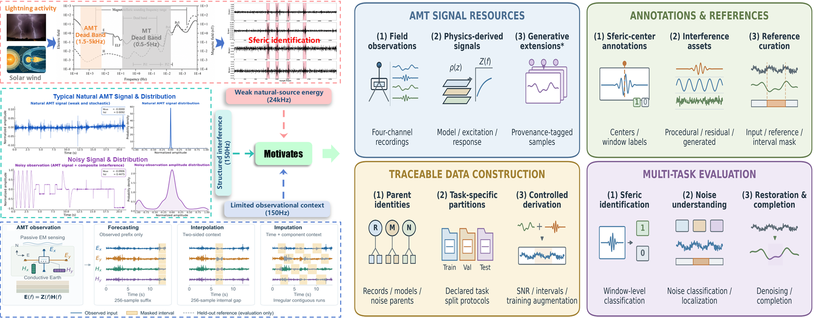
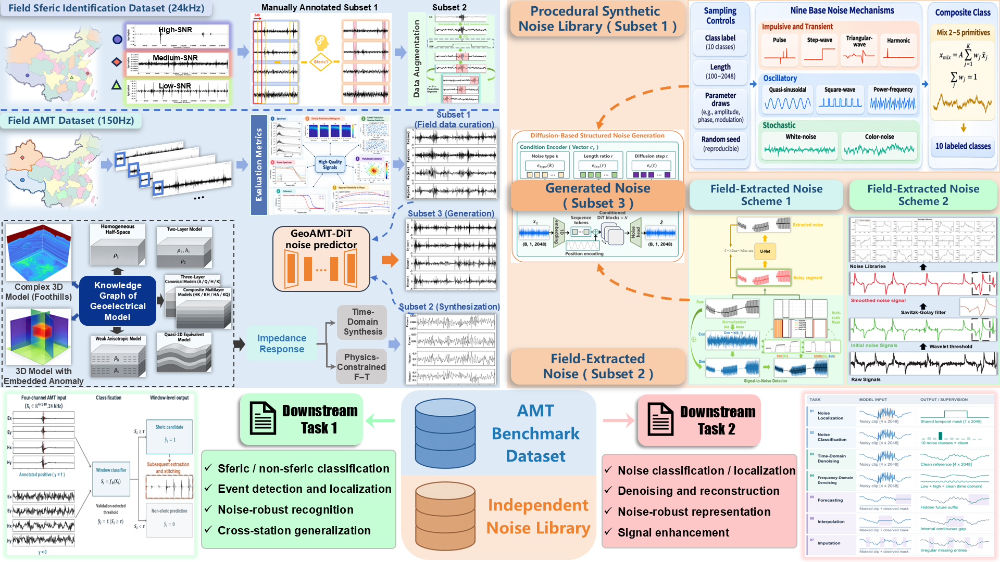

# cigAMT

**A Massive-Scale Benchmark Dataset and Baselines for Audio Magnetotelluric Signal Understanding and Restoration**

[Project page](https://jackzhangqing.github.io/cigAMT/) | [Dataset & waveform previews](https://huggingface.co/datasets/ZhangQing123/cigAMT) | [Data inventory](DATA_INVENTORY.md) | [Code](code/README.md) | [Pretrained models](code/WEIGHTS.md)

Qing Zhang, Rujun Chen, Xinming Wu, Hongchun Yao, Hui Gao, and Yimin Dou. Manuscript; public paper and supplementary links will be added when available.



cigAMT combines labeled field windows at 24 kHz with multicomponent reference signals and a separately supplied noise library at 150 Hz. It supports eight tasks under controlled interference and missing-data conditions, complemented by impedance case-analysis tools.

## Data and tasks

| Resource | Released core | Tasks |
|---|---|---|
| 24 kHz sferic windows | 16,878 original labeled windows + 11,260 fixed training augmentations; 4 x 240 | Window-level sferic identification |
| 150 Hz reference signals | 500,045 windows; 4 x 2048 | Noise classification/localization, time-domain and frequency-component denoising, forecasting, interpolation, imputation |
| Independent noise library | 718,359 templates; ten noise types and twelve support lengths | Controlled A/C noise injection |

The approximately **29.4 GB** Hugging Face core includes frozen splits, task configurations, noise schedules, and loading/replay code. It reconstructs task inputs from shared banks without the approximately 890 GB of materialized `offline` arrays. Raw/normalized versions represent the same windows and are not additive counts. See the [complete inventory](DATA_INVENTORY.md) for source/split counts, noise classes and HDF5 schemas.

The Dataset Viewer has four configurations: `sample_previews` (32 actual waveform images), `sferic_24khz`, `reference_150hz`, and `noise_library`. The last three are complete metadata indexes; `data_file`, `array_key`, and `array_row` address waveform banks.

## Dataset construction

[](docs/assets/images/construction.png)

*Construction of the 24 kHz sferic branch, the 150 Hz reference-signal branch, and the independent noise library. Reference signals combine curated field data, physics-based synthesis, and generative augmentation; noise resources combine field extraction, procedural synthesis, and conditional diffusion generation. Generated samples and sferic augmentation are restricted to training. Click the image to enlarge.*

## Installation

Clone this repository and use Python 3.10 or 3.11 with a suitable PyTorch build. Then install the module dependencies:

```bash
git clone https://github.com/jackzhangqing/cigAMT.git
cd cigAMT
python -m pip install huggingface_hub datasets
python -m pip install -r code/sferic/requirements.txt
python -m pip install -r code/amt/requirements.txt
```

Original pretrained sklearn estimators require a compatible separate environment; see [the sferic instructions](code/sferic/README.md). The optional native Razorback backend requires its own installation.

## Download the data

Choose destinations with enough free space for data and cache:

```bash
python tools/download_data.py --branch sferic --output ./data --cache ./hub_cache
python tools/download_data.py --branch amt --output ./data --cache ./hub_cache
```

```text
data/
  sferic_24khz/
    train/{windows.h5,windows.csv,records.csv}
    val/{windows.h5,windows.csv,records.csv}
    test/labeled/{windows.h5,windows.csv,records.csv}
  amt_150hz/
    clean/      # reference banks
    noise/      # templates and support metadata
    metadata/   # fixed schedules and configurations
    splits/     # frozen partitions
    code/       # task-replay readers
```

Metadata and thumbnails can be browsed without downloading signal banks:

```python
from datasets import load_dataset
preview = load_dataset("ZhangQing123/cigAMT", "sample_previews", split="examples")
preview[0]["preview_image"].show()
```

## Training and evaluation

Each command block starts from the repository root. Outputs should be outside downloaded data. CPU is used below for portability; choose a supported CUDA device for full training.

**Sferic identification** ([full instructions](code/sferic/README.md)):

```bash
cd code/sferic
python benchmark.py list-models
python benchmark.py audit --config configs/main.json --set data_root=../../data/sferic_24khz --set output_root=../../outputs/audit
python benchmark.py train --config configs/main.json --model tcn --seed 42 --set data_root=../../data/sferic_24khz --set output_root=../../outputs/sferic --device cpu
```

**Seven-task AMT benchmark** ([full instructions](code/amt/README.md)):

```bash
cd code/amt
python run.py inspect --data-root ../../data/amt_150hz --task denoising --split test --scheme A
python run.py train --data-root ../../data/amt_150hz --config configs/main_AC_bs256_budget_s42.json --task denoising --model tcn --scheme AC --seed 42 --output ../../outputs/amt_tcn --device cpu --precision fp32 --eval-after
```

The AMT module includes DLinear, PatchTST and SAITS adapters. Checkpoint-specific settings accompany each released model; one example training budget does not describe every historical run.

## Architectures and pretrained models

| Module | Implementation |
|---|---|
| Sferic neural models | [bench/models.py](code/sferic/bench/models.py): eleven architectures |
| Sferic feature models | [bench/classical.py](code/sferic/bench/classical.py): four feature classifiers and prior reference |
| Shared AMT models | [amtbench/models.py](code/amt/amtbench/models.py): six shared architectures and DLinear |
| Specialist adapters | [specialist_baselines/](code/amt/specialist_baselines/): PatchTST and SAITS |

**128 downstream inference assets** are prepared: 48 sferic assets (33 neural checkpoints and 15 sklearn estimators) and 80 AMT checkpoints. Optimizer/resume checkpoints are excluded. Together with two Noise-DiT generation checkpoints, nine archives are distributed through **GitHub Releases**, separately from Git source. See [WEIGHTS.md](code/WEIGHTS.md) and the [asset manifest](code/pretrained_assets.json) for sizes, checksums and evaluation commands. Check the [Releases page](https://github.com/jackzhangqing/cigAMT/releases) for actual attachment availability; a source push does not upload weights.

## Signal and noise generation

- [GeoAMT-DiT reference generation](code/reference_generation/README.md): actual architecture, diffusion/EMA, training, DDPM/DDIM sampling, and quality evaluation. The original pretrained generator checkpoint was not found locally; generated data remain available.
- [Conditional Noise-DiT](code/noise_generation/README.md): fixed-2048 and multi-length variants, procedural synthesis, training, sampling and descriptor diagnostics. Two run-matched inference checkpoints are included in the separate generation archive; exact historical NPZ checkpoint linkage is not recorded.

Install each generator module's own requirements before using it. The module READMEs distinguish portable new-training inputs from historical fitting data and configurations.

## Impedance estimation

The sferic module supplies continuous-record selection and a frequency-local impedance estimator. The 150 Hz module supplies the Welch-Huber extension:

```bash
cd code/amt
python impedance/run_impedance.py --input /path/to/physical_components.npy --output /path/to/case --frequencies 5 10 20 30
```

Inputs must preserve electric/magnetic amplitude relationships. Independently normalized classifier windows are not calibrated impedance inputs. Each module documents its distinct backends, units and frequency acceptance. Unpaired field cases have no known clean-reference errors.

## Verification and scope

Checks verified all 28,138 sferic inputs against the original arrays, strict architecture compatibility for all selected neural checkpoints, and bounded task-replay parity against original offline examples. Sferic TCN seed-42 full-test metrics matched the original report. These checks do not claim fresh retraining or independent reproduction of every score. See [RELEASE_CHECKS.md](RELEASE_CHECKS.md) for the verification scope.

Generated samples are assigned to benchmark training. All four labeled sferic test records are from Nanjing; this is not a cross-region test. References are curated or constructed signals, not uniformly noise-free measurements.

## Website and releases

The website is in `docs/`. Run `python preview.py` for a local preview and `python tools/check_site.py` for link, result and asset checks. GitHub Actions publishes **only docs/**. Data and checkpoint uploads are separate operations. See [PUBLISH_UPDATE_ZH.md](PUBLISH_UPDATE_ZH.md) for maintainer commands.

## Citation and licensing

```bibtex
@unpublished{zhang_cigamt,
  title = {cigAMT: A Massive-Scale Benchmark Dataset and Baselines for
           Audio Magnetotelluric Signal Understanding and Restoration},
  author = {Zhang, Qing and Chen, Rujun and Wu, Xinming and
            Yao, Hongchun and Gao, Hui and Dou, Yimin},
  note = {Manuscript. Publication details forthcoming.}
}
```

The **dataset uses CC BY-SA 4.0**. This does not replace software licenses. Vendored dependencies retain their upstream licenses; no blanket software license is assigned to authors' code by this preparation. README organization was informed by [IMIS-Bench](https://github.com/uni-medical/IMIS-Bench). Questions: [Xinming Wu](mailto:xinmwu@ustc.edu.cn), [Rujun Chen](mailto:chrujun@csu.edu.cn).
